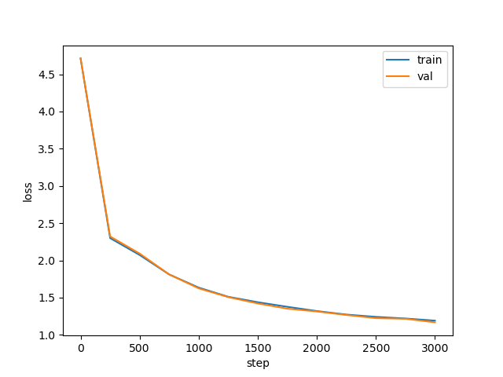

# Lab 03 – Developing a Tiny Transformer Language Model

## Objective
Build, train and evaluate a small decoder-only Transformer (GPT-style) language model from scratch using PyTorch on the TinyStories dataset.

## Dataset
`roneneldan/TinyStories` (Hugging Face). A subset of 3,000 stories was used, tokenized at **character level** (90/10 train/validation split).

## Architecture
- Token embeddings + learned positional embeddings
- N × Transformer blocks, each with:
  - Masked (causal) multi-head self-attention
  - Feed-forward network (4× expansion, GELU)
  - Residual connections and Layer Normalization (pre-norm)
- Final LayerNorm + linear output head

| Setting | Value |
|---------|-------|
| Layers | 4 |
| Attention heads | 4 |
| Embedding size | 128 |
| Context length | 128 |
| Dropout | 0.1 |
| Parameters | ~0.83 M |
| Optimizer | AdamW (lr 3e-4), gradient clipping 1.0 |
| Training steps | 3,000 (batch size 64) |

## Results
| Step | Train loss | Val loss | Perplexity |
|------|-----------|----------|------------|
| 0 | 4.686 | 4.690 | 108.81 |
| 1000 | 1.666 | 1.664 | 5.28 |
| 2000 | 1.346 | 1.338 | 3.81 |
| 3000 | 1.213 | 1.213 | **3.36** |

### Generated text (prompt: "Once upon a time")